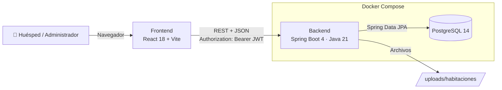
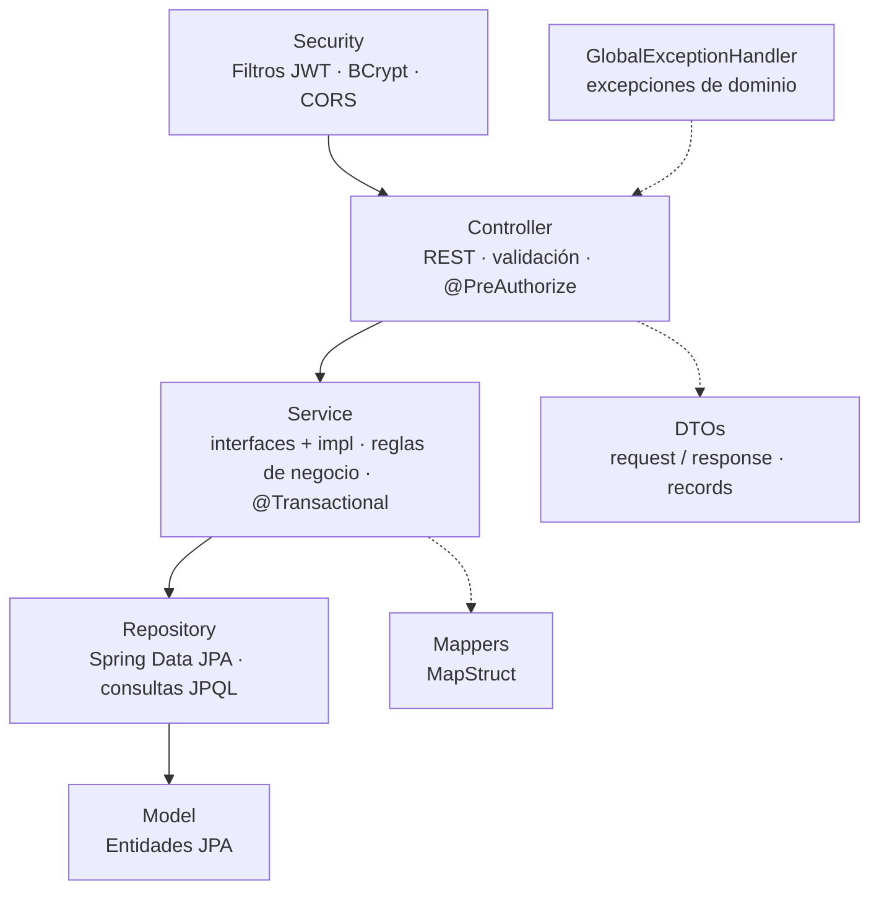
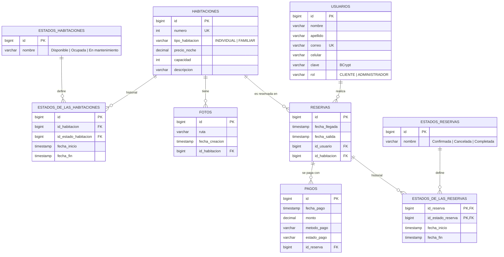
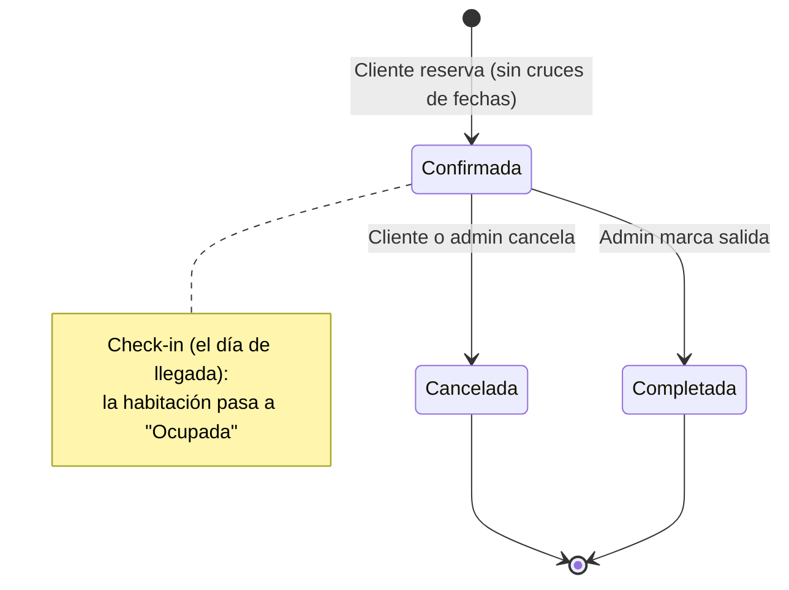

# 🏨 Verdant Hotel – Sistema de Gestión de Reservas Hoteleras

Plataforma web **fullstack** que digitaliza la operación de reservas de un hotel. Los huéspedes pueden explorar las habitaciones, consultar la disponibilidad y reservar en línea. El personal del hotel administra habitaciones, reservas, check-in/check-out y usuarios desde un panel centralizado.

Construido con **Spring Boot 4 (Java 21)**, **React 18**, **PostgreSQL** y **Docker**, priorizando la arquitectura en capas, un modelado de dominio cuidadoso, la seguridad con **JWT** y reglas de negocio que reflejan la operación real de un hotel.

> 🚧 Proyecto personal en desarrollo activo.

---

## 📑 Tabla de contenido

- [El problema](#-el-problema)
- [La solución](#-la-solución)
- [Funcionalidades](#-funcionalidades)
- [Reglas de negocio](#-reglas-de-negocio)
- [Arquitectura](#-arquitectura)
- [Modelo de datos](#-modelo-de-datos)
- [Seguridad](#-seguridad)
- [Tecnologías](#-tecnologías)
- [Estructura del repositorio](#-estructura-del-repositorio)
- [API REST](#-api-rest)
- [Ejecución local](#️-ejecución-local)
- [Estado y hoja de ruta](#-estado-y-hoja-de-ruta)
- [Autor](#-autor)

---

## ❗ El problema

Muchos hoteles pequeños y medianos todavía gestionan sus reservas con hojas de cálculo, cuadernos, llamadas telefónicas o mensajes de WhatsApp. Esto genera problemas recurrentes:

| Problema | Consecuencia para el hotel |
|---|---|
| **Sobreventa (overbooking)**: dos clientes reservan la misma habitación en fechas que se cruzan | Clientes molestos, reubicaciones de emergencia, reseñas negativas |
| **Sin visibilidad de la disponibilidad real** | El huésped tiene que llamar o escribir para saber si hay cupo, y se pierden ventas fuera del horario de atención |
| **Estado de las habitaciones desactualizado** (ocupada, libre, en mantenimiento) | Se asignan habitaciones que no están listas |
| **Sin trazabilidad**: no se sabe cuándo se confirmó, canceló o completó una reserva | Es difícil auditar, resolver reclamos o medir la operación |
| **Control de acceso débil**: cualquiera puede modificar la información | Errores humanos y riesgo de manipulación de datos |
| **Información dispersa** sobre habitaciones, precios, fotos y clientes | Atención lenta e inconsistente |

---

## ✅ La solución

**Verdant Hotel** centraliza toda la operación de reservas en una sola aplicación web, con reglas de negocio que se validan en el servidor:

- 🔒 **Evita el overbooking**: antes de guardar una reserva, el backend consulta si existe otra reserva *confirmada* que se cruce con el rango de fechas solicitado y, si la hay, la rechaza.
- 🌐 **Reservas en línea 24/7**: un catálogo público permite filtrar habitaciones por tipo, precio y **disponibilidad entre fechas**, ver sus fotos y reservar con el costo total calculado automáticamente.
- 🛏️ **Estado de habitaciones en tiempo real**: al hacer el check-in, la habitación pasa automáticamente a *Ocupada*. Cada habitación conserva su historial de estados (*Disponible*, *Ocupada*, *En mantenimiento*).
- 🧾 **Trazabilidad completa**: cada reserva guarda un **historial de estados con fecha de inicio y fin** (*Confirmada → Cancelada* o *Confirmada → Completada*), así que siempre se sabe qué pasó y cuándo.
- 👥 **Roles y permisos**: los **clientes** solo gestionan sus propias reservas y los **administradores** controlan habitaciones, reservas y usuarios. La API lo garantiza con JWT y autorización por rol.
- 🗂️ **Información centralizada**: habitaciones con número, tipo, capacidad, precio por noche, descripción y galería de fotos, disponibles tanto para el personal como para el huésped.

---

## ✨ Funcionalidades

### 🌍 Visitante (sin iniciar sesión)
- Catálogo paginado de habitaciones con tarjetas informativas e imagen de portada.
- **Barra lateral de filtros**: filtrado independiente por **tipo** (Individual / Familiar), **rango de precio** (mínimo y máximo) y **disponibilidad entre fechas** (consultando disponibilidad real en backend).
- Detalle de cada habitación con su información técnica, precio por noche y galería de fotos.
- Registro de cuenta de cliente e inicio de sesión.

### 🧳 Cliente
- **Reserva interactiva (`BookRoom`)**: calendario mensual navegable que **bloquea en rojo las fechas ocupadas** (incluyendo rangos completos de reservas existentes) para impedir selección de fechas no disponibles.
- Desglose automático de noches calculadas y costo total según el precio por noche.
- **Mis reservas (`MyBookings`)**: organizadas por **secciones con pestañas** (*Confirmadas*, *Completadas* y *Canceladas*, mostrando *Confirmadas* por defecto).
- Tarjetas informativas con fechas formateadas, número de noches y estado visual.
- **Cancelación de reservas**: opción de cancelar reservas activas (Confirmadas) con diálogo de confirmación y actualización inmediata.

### 🛎️ Administrador
- **Gestión de Reservas (`AdminBookings`)**:
  - Búsqueda de reservas de clientes por **nombre completo** y filtro opcional por **número de habitación**.
  - Visualización del estado actual de la habitación en tiempo real (*Disponible*, *Ocupada*, *En mantenimiento*).
  - **Check-in (Marcar entrada)**: habilitado cuando la habitación está *Disponible* y la fecha actual coincide con la fecha de llegada de la reserva.
  - **Check-out (Marcar salida)**: habilitado de forma intuitiva cuando la habitación está *Ocupada*, completando la reserva y liberando la habitación sin restricciones rígidas de fecha.
- **Habitaciones**: crear, editar y eliminar habitaciones, y subir o eliminar múltiples fotos por habitación.
- **Usuarios**: listado paginado, filtrado por rol y eliminación de usuarios.

### 🎨 Experiencia de usuario
- Interfaz responsive con un sistema de diseño propio (*Nocturne*, basado en design tokens en CSS).
- **Modo claro / oscuro** persistente.
- Alertas y confirmaciones con SweetAlert2.
- Rutas protegidas en el frontend y sesión basada en JWT.

---

## 📐 Reglas de negocio

Todas las reglas se validan en el **backend**, así que no dependen del cliente:

1. **Sin reservas cruzadas**: una habitación no puede tener dos reservas *confirmadas* con rangos de fechas que se solapen (`ReservaCruzadaException` $\rightarrow$ 409 Conflict).
2. **Fechas coherentes**: la fecha de salida no puede ser anterior a la de llegada (`FechasReservaInvalidasException` $\rightarrow$ 400 Bad Request).
3. **Zona horaria estandarizada**: backend (JVM, Jackson e Hibernate) configurados bajo la zona horaria `America/Bogota` (UTC-5), evitando desfases de días u horas entre cliente y servidor.
4. **Check-in validado**: solo se puede marcar la entrada el mismo día de llegada (`FechaLlegadaNoIgualFechaActualException` $\rightarrow$ 409 Conflict), si la reserva está *Confirmada* y la habitación está *Disponible* (`EstadoHabitacionInvalidoException` $\rightarrow$ 409 Conflict). Al registrar la entrada, la habitación cambia automáticamente a *Ocupada*.
5. **Check-out y cierre de estadía**: para marcar la salida, la reserva debe estar *Confirmada* y la habitación debe estar actualmente *Ocupada* (garantizando check-in previo). No se restringe a un día específico para permitir check-outs anticipados o por urgencia. Al marcar la salida, la reserva pasa a *Completada* y la habitación vuelve a *Disponible*.
6. **Propiedad de la reserva**: solo el dueño de la reserva (o un administrador) puede cancelarla. El usuario se obtiene del **token JWT**, nunca de datos enviados por el cliente. Solo se pueden cancelar reservas en estado *Confirmada*.
7. **Control de existencia**: ante identificadores inexistentes se responde de manera precisa con `ReservaNoEncontradaException` $\rightarrow$ 404 Not Found o `HabitacionNoEncontradaException` $\rightarrow$ 404 Not Found.
8. **Número de habitación único** (`NumeroHabitacionRepetidaException` $\rightarrow$ 409 Conflict) y **correo de usuario único** (`UsuarioRegistrarCorreoExistenteExcepcion` $\rightarrow$ 409 Conflict).
9. **Imágenes validadas**: solo se aceptan archivos con content-type `image/*` (`TipoImagenIncorrectoException`), hasta 10 MB, y se guardan con nombres `UUID` para evitar colisiones.
10. **Historial inmutable de estados**: cada cambio de estado cierra el anterior (`fecha_fin`) y abre uno nuevo (`fecha_inicio`), sin sobrescribir el historial ni de reservas ni de habitaciones.

Los errores se traducen a respuestas HTTP claras mediante un `GlobalExceptionHandler` centralizado.

---

## 🧱 Arquitectura

### Vista general



### Backend: arquitectura en capas



| Capa | Responsabilidad |
|---|---|
| `controller` | Expone los endpoints REST, valida la entrada con Bean Validation y aplica la autorización por rol |
| `service` / `service.impl` | Contiene la lógica de negocio (solapamiento de reservas, transiciones de estado, check-in/out) dentro de transacciones |
| `repository` | Acceso a datos con Spring Data JPA y consultas JPQL personalizadas (disponibilidad, reservas cruzadas, historial) |
| `model` | Entidades JPA y enums del dominio |
| `dto` | Objetos de entrada/salida desacoplados de las entidades, para no exponer el modelo interno |
| `mapper` | Conversión entidad ↔ DTO con MapStruct, generada en tiempo de compilación |
| `config.security` | Cadena de filtros de Spring Security: autenticación y validación de JWT, CORS y Swagger |
| `exception` | Excepciones de dominio y su traducción a respuestas HTTP |

### Frontend

- **SPA con React 18 + Vite** y **React Router 6**.
- Capa `api/` que agrupa las llamadas `fetch` al backend por recurso (`auth`, `rooms`, `bookings`, `users`).
- `context/` para el estado global (`AuthContext` para la sesión, `ThemeContext` para el tema).
- `SecurityRoute` protege las rutas que requieren autenticación, validando el JWT con `jwt-decode`.
- Páginas separadas para cliente (`pages/`) y administrador (`pages/admin/`).

---

## 🗄️ Modelo de datos

El dominio se diseñó primero con un modelo conceptual, un modelo lógico y un diagrama de clases, y después se implementó en JPA. Los **estados se modelan como historial**: tablas intermedias con `fecha_inicio` / `fecha_fin`, en lugar de un simple campo de texto. Así se puede auditar toda la vida de una reserva o habitación.



### Ciclo de vida de una reserva



El script <code>backend/creacion_de_tablas.sql</code> crea el esquema e inserta los estados iniciales de forma automática cuando arranca el contenedor de PostgreSQL.

---

## 🔐 Seguridad

- **Autenticación stateless con JWT** (jjwt, firma HS256). El token expira a los 15 minutos y lleva el rol del usuario.
- **Filtros personalizados**: `JwtAuthenticationFilter` hace el login y emite el token, y `JwtValidationFilter` lo valida en cada petición.
- **Contraseñas con BCrypt**, nunca en texto plano.
- **Autorización por rol** con `@PreAuthorize("hasAuthority('ADMINISTRADOR')")` en los endpoints administrativos.
- **Endpoints públicos limitados** al catálogo, los filtros, las fotos, el registro y Swagger. Todo lo demás requiere token.
- **Verificación de propiedad**: el usuario se obtiene del token (`@AuthenticationPrincipal`), así que un cliente no puede reservar ni cancelar a nombre de otro.
- **Secretos externalizados**: la clave de firma JWT y las credenciales de la base de datos se leen de variables de entorno (`backend/.env`, excluido de git).
- **CORS** configurado a nivel de aplicación.

---

## 🔧 Tecnologías

### Backend
| Tecnología | Uso |
|---|---|
| **Java 21** | Lenguaje (records para los DTOs) |
| **Spring Boot 4** (Web MVC) | Framework de la API REST |
| **Spring Data JPA / Hibernate** | Persistencia y consultas JPQL |
| **Spring Security** | Autenticación y autorización |
| **JJWT 0.13** | Generación y validación de tokens JWT |
| **Jakarta Bean Validation** | Validación de las peticiones |
| **MapStruct 1.5** | Mapeo entidad ↔ DTO |
| **Lombok** | Menos código repetitivo |
| **springdoc-openapi (Swagger UI)** | Documentación interactiva de la API |
| **Apache Commons IO** | Manejo de archivos de imagen |
| **Maven** | Build y dependencias |

### Frontend
| Tecnología | Uso |
|---|---|
| **React 18** | Interfaz de usuario |
| **Vite 5** | Bundler y servidor de desarrollo |
| **React Router 6** | Enrutamiento y rutas protegidas |
| **jwt-decode** | Lectura del JWT en el cliente |
| **SweetAlert2** | Alertas y confirmaciones |
| **CSS con design tokens** | Sistema de diseño propio y modo claro/oscuro |

### Base de datos e infraestructura
| Tecnología | Uso |
|---|---|
| **PostgreSQL 14** | Base de datos relacional |
| **Docker** (build multi-etapa) | Imagen del backend: compila con Maven y ejecuta con un JRE ligero |
| **Docker Compose** | Orquestación de backend y base de datos, con volúmenes persistentes |

---

## 📁 Estructura del repositorio

```
Proyecto-Hotel/
├── compose.yml                     # Orquestación: backend + PostgreSQL
├── backend/
│   ├── Dockerfile                  # Build multi-etapa (Maven → JRE 21)
│   ├── creacion_de_tablas.sql      # Esquema + datos iniciales
│   ├── pom.xml
│   └── src/main/java/com/hotel/proyecto/proyecto_hotel/
│       ├── controller/             # Endpoints REST
│       ├── service/                # Interfaces de servicio
│       │   └── impl/               # Lógica de negocio
│       ├── repository/             # Spring Data JPA
│       ├── model/                  # Entidades JPA
│       │   └── enums/              # Rol, TipoHabitacion, MetodoPago, EstadoPago
│       ├── dto/request|response/   # DTOs de entrada/salida
│       ├── mapper/                 # MapStruct
│       ├── exception/              # Excepciones de dominio + handler global
│       └── config/                 # Seguridad, JWT, CORS, Swagger
└── frontend/
    ├── package.json
    └── src/
        ├── api/                    # Cliente HTTP por recurso
        ├── components/             # Navbars, tarjetas, rutas protegidas, modal
        ├── context/                # Autenticación y tema
        ├── pages/                  # Catálogo, detalle, reserva, mis reservas, login
        │   └── admin/              # Panel de administración
        └── styles/                 # Sistema de diseño
```

---

## 🔌 API REST

URL base: `http://localhost:8181/hotel/api`

| Método | Endpoint | Acceso | Descripción |
|---|---|---|---|
| `POST` | `/login` | Público | Inicia sesión y devuelve un JWT |
| `POST` | `/usuarios` | Público | Registra un cliente |
| `GET` | `/usuarios` · `/usuarios/byRol/{rol}` | Admin | Lista usuarios |
| `DELETE` | `/usuarios/{id}` | Admin | Elimina un usuario |
| `GET` | `/habitaciones` | Público | Lista paginada de habitaciones |
| `GET` | `/habitaciones/{id}` | Público | Detalle de una habitación |
| `GET` | `/habitaciones/tipo/{tipo}` | Público | Filtra por tipo |
| `GET` | `/habitaciones/precio?precioMinimo=&precioMaximo=` | Público | Filtra por rango de precio |
| `GET` | `/habitaciones/disponibilidad_fecha?fechaLlegada=&fechaSalida=` | Público | Habitaciones disponibles en un rango |
| `POST` · `PUT` · `DELETE` | `/habitaciones` · `/habitaciones/{id}` | Admin | Crea, edita o elimina una habitación |
| `POST` | `/habitaciones/{id}/fotos` | Admin | Sube una foto |
| `GET` | `/fotos/habitacion/{id}` · `/fotos/first/habitacion/{id}` | Público | Fotos / foto de portada |
| `DELETE` | `/fotos/{id}` | Admin | Elimina una foto |
| `POST` | `/reservas` | Autenticado | Crea una reserva (valida cruces de fechas) |
| `GET` | `/reservas/mis_reservas?estado=` | Autenticado | Historial del usuario por estado |
| `PUT` | `/reservas/cancelar/{id}` | Dueño / Admin | Cancela una reserva |
| `GET` | `/reservas/habitaciones/{id}` | Autenticado | Reservas confirmadas de una habitación |
| `GET` | `/reservas/clientes/{nombreCompleto}` | Autenticado | Busca reservas por cliente |
| `POST` | `/reservas/marcar-entrada/{id}` | Admin | Check-in |
| `POST` | `/reservas/marcar-salida/{id}` | Admin | Check-out |

📖 Documentación interactiva (Swagger UI): `http://localhost:8181/hotel/api/swagger-ui/index.html`

Para probar endpoints protegidos desde Swagger, inicia sesión en `POST /login`, copia el token y pégalo en **Authorize** (`bearerAuth`).

---

## ▶️ Ejecución local

### Requisitos
- Docker y Docker Compose
- Node.js 18+ (para el frontend)

### 1. Clonar el repositorio
```bash
git clone https://github.com/AlfonsoMSDL/Proyecto-Hotel.git
cd Proyecto-Hotel
```

### 2. Configurar variables de entorno
Crea `backend/.env` (no se incluye en el repositorio):

```env
POSTGRES_USER=<usuario_de_postgres>
POSTGRES_DB=<nombre_de_la_base_de_datos>
POSTGRES_PASSWORD=<contraseña_de_postgres>
POSTGRES_HOST=bd
SECRET_KEY_BACKEND=<clave_base64_de_al_menos_32_bytes>
```

Puedes generar la clave con:
```bash
openssl rand -base64 32
```

### 3. Levantar backend y base de datos
```bash
docker compose up --build
```
- API: `http://localhost:8181/hotel/api`
- PostgreSQL expuesto en el puerto `55432` del host

### 4. Levantar el frontend
```bash
cd frontend
npm install
npm run dev
```
- App: `http://localhost:5173`

> Los usuarios que se registran desde la app tienen rol **CLIENTE**. Para probar el panel de administración, cambia el `rol` de un usuario a `ADMINISTRADOR` directamente en la base de datos.

---

## 🗺️ Estado y hoja de ruta

**Implementado**
- ✅ API REST completa de usuarios, habitaciones, fotos y reservas
- ✅ Autenticación JWT y autorización por roles
- ✅ Validación de reservas cruzadas y flujo completo de check-in / check-out
- ✅ Estandarización de zona horaria (`America/Bogota`) en JVM, Hibernate y Jackson
- ✅ Historial inmutable de estados para reservas y habitaciones
- ✅ Frontend en React: catálogo con filtros laterales (tipo, precio y fechas), detalle, reserva interactiva con calendario bloqueado, mis reservas agrupadas por pestañas, login/registro
- ✅ Panel de administración completo: gestión de habitaciones, fotos, usuarios y gestión de reservas con check-in y check-out en tiempo real
- ✅ Contenerización del backend y la base de datos con Docker Compose

**En progreso / próximos pasos**
- 🔄 Protección estricta de las rutas de administración por rol en el frontend
- ⏳ Integración de pasarela de pagos (el modelo `Pago` ya existe)
- ⏳ Notificaciones por correo (confirmación y cancelación de reservas)
- ⏳ Frontend dentro de `compose.yml` y URL del backend configurable por variables de entorno
- ⏳ Perfiles dev/prod y CORS restringido a orígenes concretos
- ⏳ Pruebas unitarias y de integración
- ⏳ CI/CD y despliegue en AWS

---

## 👤 Autor

**Alfonso Salazar de León** · [GitHub @AlfonsoMSDL](https://github.com/AlfonsoMSDL)

¿Tienes comentarios o sugerencias? Abre un *issue* o escríbeme.
